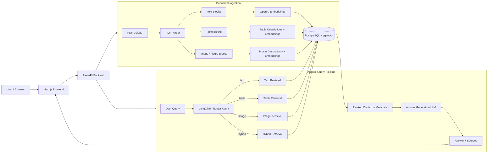

<div align="center">

# Multimodal Agentic RAG Platform

**Full-stack multimodal retrieval system combining document intelligence, agentic routing, vector search, FastAPI, PostgreSQL/pgvector, and Next.js.**


Maintained by **Nour Ghribi**  
Target repository: [`Nour-Ghribi/multimodal-agentic-rag-platform`](https://github.com/Nour-Ghribi/multimodal-agentic-rag-platform)

</div>

---

## Overview

This project is a full-stack **Multimodal Agentic RAG platform** for indexing and querying PDF documents that contain mixed modalities: text, tables, figures, diagrams and extracted images.

Most basic RAG systems flatten every document into text chunks. This platform keeps modality-specific retrieval paths:

- **Text chunks** for narrative prose, explanations and definitions.
- **Table chunks** for numeric values, comparisons, rows and columns.
- **Image chunks** for figures, screenshots, charts and diagrams.
- **Hybrid retrieval** when a query requires more than one modality.

An agentic router classifies the user query into the right retrieval mode before searching PostgreSQL/pgvector. The backend then assembles grounded context and calls an LLM to produce an answer with source metadata.

## Architecture Workflow



## Key Features

| Capability | Implementation |
| --- | --- |
| PDF ingestion | Upload endpoint saves PDFs, parses documents page-by-page and indexes extracted blocks. |
| Multimodal parsing | Parser separates text, tables and image/figure content. |
| Agentic routing | LangChain structured output classifies queries into `text`, `table`, `image` or `hybrid`. |
| Vector search | PostgreSQL with pgvector stores embeddings and supports similarity retrieval. |
| Backend API | FastAPI exposes indexing, querying, document listing and health endpoints. |
| Frontend app | Next.js UI provides the user-facing query and results experience. |
| Observability | Optional Langfuse tracing for indexing and query pipelines. |
| Containerized runtime | Docker Compose starts Postgres/pgvector, FastAPI and Next.js together. |

## System Components

### Backend: `MULTIMODAL_RAG/`

- `api/` - FastAPI app, schemas, services and HTTP endpoints.
- `agent/` - query router agent that chooses retrieval modality.
- `parser/` - PDF parsing and block extraction.
- `indexer/` - embedding and pgvector persistence.
- `retriever/` - pgvector similarity search across modality-specific chunks.
- `evaluation/` - optional golden-dataset evaluation harness.
- `config/` - environment-driven settings.

### Frontend: `multimodal-rag-ui/`

- `app/` - Next.js application entry points.
- `components/` - UI components for answers, sources, routing badges and layout.
- `hooks/` - client-side RAG hooks.
- `lib/` - frontend service wrapper and utilities.

### Infrastructure

- `docker-compose.yml` starts:
  - PostgreSQL with pgvector.
  - FastAPI backend.
  - Next.js frontend.
- `MULTIMODAL_RAG/indexer/schema.sql` initializes database tables and vector indexes.

## Retrieval Flow

1. A user asks a question in the Next.js UI.
2. The frontend sends the query to the FastAPI `/query` endpoint.
3. The router agent classifies the query as `text`, `table`, `image` or `hybrid`.
4. The retriever searches the relevant pgvector table(s).
5. Retrieved chunks are partitioned into text sources, table sources and image sources.
6. The answer service builds a labelled context with document ids, pages and similarity scores.
7. The answer LLM produces a final response grounded in retrieved context.

## Document Ingestion Flow

1. PDFs are uploaded through `/index`.
2. The backend stores uploaded files in the configured upload directory.
3. The parser extracts structured document blocks.
4. Tables may be described using an LLM or deterministic formatting.
5. Each block is embedded with the configured OpenAI embedding model.
6. Chunks are stored in PostgreSQL/pgvector with metadata for document id, page and modality.

## API Endpoints

| Endpoint | Method | Purpose |
| --- | --- | --- |
| `/health` | GET | Liveness check. |
| `/documents` | GET | List indexed documents and chunk counts. |
| `/index` | POST | Upload and index one or more PDFs. |
| `/query` | POST | Ask a question and receive answer, route, reasoning and sources. |
| `/docs` | GET | FastAPI interactive API documentation. |

## Environment Configuration

Copy the example files before running locally:

```bash
cp .env.example .env
cp MULTIMODAL_RAG/.env.example MULTIMODAL_RAG/.env
cp multimodal-rag-ui/.env.example multimodal-rag-ui/.env.local
```

Important variables:

| Variable | Purpose |
| --- | --- |
| `POSTGRES_PASSWORD` | Root Docker Compose database password override. |
| `DATABASE_URL` | Backend PostgreSQL connection string. |
| `OPENAI_API_KEY` | Required for embeddings, routing and answer generation. |
| `OPENAI_EMBEDDING_MODEL` | Embedding model, default `text-embedding-3-small`. |
| `OPENAI_ROUTER_MODEL` | Router LLM, default `gpt-4o-mini`. |
| `OPENAI_ANSWER_MODEL` | Answer generation LLM, default `gpt-4o-mini`. |
| `USE_LLM_TABLE_DESCRIPTIONS` | Toggle LLM table descriptions. |
| `RAG_TOP_K` | Default number of retrieved chunks. |
| `LANGFUSE_*` | Optional tracing configuration. |
| `NEXT_PUBLIC_API_URL` | Frontend URL for the FastAPI backend. |

No real API keys or secrets should be committed.

## Quick Start

### Docker Compose

```bash
git clone https://github.com/Nour-Ghribi/multimodal-agentic-rag-platform.git
cd multimodal-agentic-rag-platform

cp .env.example .env
cp MULTIMODAL_RAG/.env.example MULTIMODAL_RAG/.env
cp multimodal-rag-ui/.env.example multimodal-rag-ui/.env.local
```

Edit `MULTIMODAL_RAG/.env` and set `OPENAI_API_KEY`.

```bash
docker compose up --build
```

Services:

| Service | URL |
| --- | --- |
| Frontend | `http://localhost:3000` |
| Backend API docs | `http://localhost:8000/docs` |
| Health check | `http://localhost:8000/health` |

### Backend only

```bash
cd MULTIMODAL_RAG
python -m venv .venv
.venv\Scripts\activate
pip install -r requirements.txt
python -m uvicorn api.main:app --reload
```

### Frontend only

```bash
cd multimodal-rag-ui
npm install
npm run dev
```

## Lightweight Validation

These checks do not train models and do not download large datasets.

```bash
# Backend syntax/import compilation
python -m compileall MULTIMODAL_RAG

# Frontend static checks, after npm install
cd multimodal-rag-ui
npm run lint
```

The full runtime requires PostgreSQL/pgvector and an OpenAI API key.

## Repository Structure

```text
.
├── docker-compose.yml
├── .env.example
├── MULTIMODAL_RAG/
│   ├── api/
│   ├── agent/
│   ├── config/
│   ├── evaluation/
│   ├── indexer/
│   ├── parser/
│   ├── retriever/
│   ├── scripts/
│   ├── .env.example
│   ├── Dockerfile
│   └── requirements.txt
└── multimodal-rag-ui/
    ├── app/
    ├── components/
    ├── hooks/
    ├── lib/
    ├── public/
    ├── .env.example
    ├── Dockerfile
    └── package.json
```

## What Is Not Committed

The repository intentionally excludes:

- Real `.env` files and `.env.local`.
- Next.js build output (`.next/`).
- Python caches and virtual environments.
- Uploaded PDFs.
- Extracted document images.
- Evaluation output reports.
- Runtime logs and local machine paths.

## Notes and Limitations

- The application requires real OpenAI credentials to run the full query/indexing pipeline.
- The Docker setup expects pgvector-compatible PostgreSQL.
- Generated document artifacts can become large and should remain outside Git.
- The evaluation harness is included, but no benchmark results are claimed here.
- No models are trained or fine-tuned by this repository.

